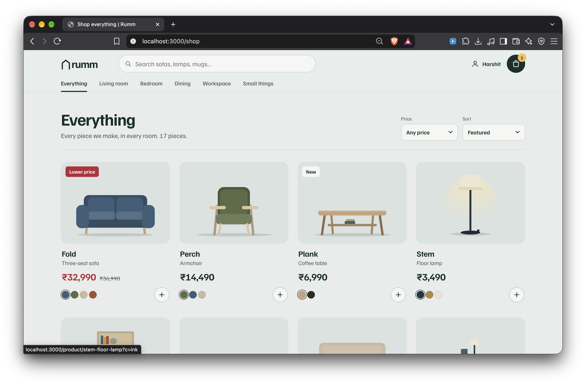

# Rumm



A full-stack furniture store built with Next.js 15 (App Router), React 19 and TypeScript, with MongoDB through Mongoose.

## Run it

You need a MongoDB database. A free [MongoDB Atlas](https://www.mongodb.com/atlas) cluster works well.

```bash
npm install
cp .env.example .env.local    # paste your Atlas connection string into .env.local
npm run db:seed               # adds stock for every product and builds the indexes
npm run dev                   # http://localhost:3000
```

`npm run db:seed` never resets stock that already exists, so it's safe to run again after adding products.

## What's in it

**Storefront**
- **Home:** an interactive living room. On load, the furniture drops into place and then the lamp switches on. Every piece has a hotspot showing its price with an *Add to bag* button. The room has three colour schemes, and *Add the whole room* adds all eight pieces in the chosen colours.
- **Shop** (`/shop`): filter by room, price and search, with sorting. Swatches on each card recolour its illustration, and the + button adds the item to the bag.
- **Product** (`/product/[slug]`): colour picker (the backdrop tints to match), quantity, live stock, delivery date, parts count, assembly time, and related products.
- **Bag drawer:** quantity steppers, a progress bar toward free delivery, and a fly-to-bag animation whenever you add something.
- **Checkout:** Indian address validation (10-digit mobile, 6-digit PIN), an optional paid assembly service, and cash or UPI on delivery.
- **Accounts:** register, sign in and sign out, with order history and an order confirmation page that shows a tracker.

**Backend (`app/api/*`)**

| Route | Method | Purpose |
| --- | --- | --- |
| `/api/products` | GET | Catalogue with filters (`room`, `max`, `sort`, `q`) and live stock |
| `/api/cart` | GET / POST / PATCH | Read the bag, add items (single or `items[]`), set a quantity (0 removes) |
| `/api/auth/register` | POST | Create an account and start a session |
| `/api/auth/login` | POST | Sign in |
| `/api/auth/logout` | POST | Sign out |
| `/api/auth/me` | GET | Current user |
| `/api/orders` | GET / POST | Your orders / place an order from the bag (checks and decrements stock) |

- Passwords are hashed with scrypt and compared in constant time. Sessions use random 256-bit tokens in httpOnly cookies.
- Guests can check out. An order page is visible only to the account that placed it, or to the browser that placed it.
- Data lives in MongoDB. Mongoose models are in `models/`; routes import from `lib/store.ts`, which re-exports the users, cart and orders modules.
- Placing an order runs in a MongoDB transaction. Stock is taken with a conditional update, so two customers can never both buy the last one.
- Bag updates check the document version, so two quick taps on "Add" both count.
- Sessions and abandoned bags expire on their own through TTL indexes.

## Design notes

- **Type:** Familjen Grotesk, loaded with `next/font`.
- **Palette:** cool frost background, spruce text, pine for actions, lingonberry red for sale prices, and a sun-yellow accent.
- **Illustrations:** every product is drawn in SVG (`components/ProductArt.tsx`) so colourways really recolour it. To use photos, add an `image` field to the products and render it in place of `ProductArt`.
- **Motion:** one orchestrated moment on load (the room assembling). Everything else responds to the user: hotspots, the fly-to-bag arc, the drawer, swatches, accordions and toasts. It all switches off under `prefers-reduced-motion`.

## Deploying to Vercel

1. In Atlas, open **Network Access** and allow `0.0.0.0/0` (Vercel's servers don't have fixed addresses).
2. Import the GitHub repo in Vercel and add `MONGODB_URI` under **Settings → Environment Variables**.
3. Deploy, then run `npm run db:seed` once from your machine if the database is new.

Transactions need a replica set. Atlas clusters (including the free one) are replica sets; a plain local `mongod` is not.

## Next steps

- Add a payment gateway (e.g. Razorpay) for prepaid orders.
- Send confirmation emails from `POST /api/orders`.
